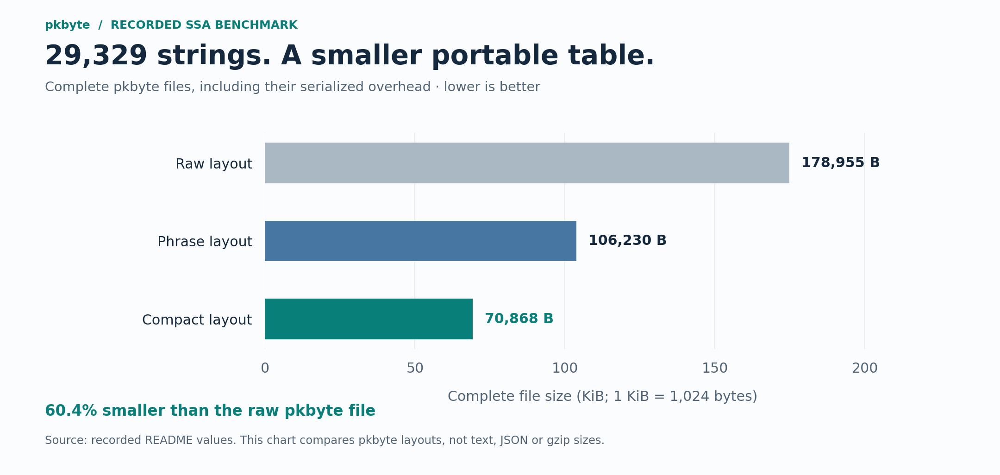
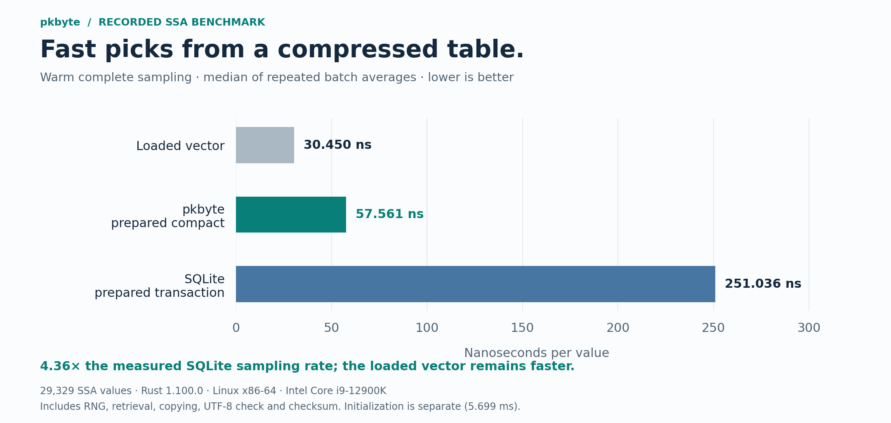

# pkbyte

## Tiny string tables. Fast random picks.

pkbyte turns a collection of unique strings into a compact, portable table. Open it once, then repeatedly pick one of its original values at random. It combines compressed storage with direct access to individual values, giving Rust applications a small catalog they can ship as a file or embed in an executable.

**Pack once. Open once. Pick repeatedly.**

[Quick start](#try-it) · [Benchmarks](#benchmarks) · [Architecture and algorithms](#architecture-and-algorithms) · [Technical design](docs/TECHNICAL-DESIGN.md) · [Usage guide](docs/README-GUIDE.md)

Use it for:

- **Test fixtures and demos:** draw names, places, labels, or identifiers from a curated collection.
- **Games and procedural content:** ship catalogs of character names, locations, traits, and prompts.
- **Offline applications and CLI tools:** distribute a reusable string collection with your program.
- **Multilingual sample data:** preserve exact UTF-8 values, including Japanese, whitespace, and empty strings.

### Measured advantages

On the recorded **29,329-value SSA names dataset**:

| Complete compact table | Average storage per value | Smaller than pkbyte's raw layout | Sampling rate vs. prepared SQLite |
| ---: | ---: | ---: | ---: |
| **70,868 bytes** | **2.42 bytes** | **60.4%** | **4.36×** |

The compact reader samples a value in **57.561 ns** in the recorded warm benchmark. These measurements describe the same dataset and prepared workload; initialization is separate. [See the benchmark tables, charts, and conditions.](#benchmarks)

## Try it

### From the command line

pkbyte requires Rust **1.74 or newer**. The library and CLI use the standard library.

For a release published on crates.io, install the CLI with this command.

```sh
cargo install pkbyte --locked
```

To try the **0.1.1** candidate before publication, run this command from the source checkout or unpacked `.crate`.

```sh
cargo install --path . --locked --offline
```

Put one nonempty value per line in `values.txt`, then run:

```sh
pkbyte pack values.txt
pkbyte pick values.npk
```

`pack` chooses a compact layout and writes `values.npk`. `pick` writes one JSON string to stdout. Each pick is made **with replacement**, so repeated values are expected.

```sh
pkbyte pick values.npk -n 10             # Draw ten values
pkbyte pick values.npk -n 10 --seed 42   # Repeat a seeded sequence
pkbyte info values.npk                  # Inspect the table
pkbyte verify values.npk                # Validate all values and uniqueness
pkbyte unpack values.npk                # Export every value as JSON Lines
```

Run `pkbyte` for an overview or `pkbyte pack --help` for options. Installation details and archive checksums are in the [local release guide](docs/RELEASE.md).

### From Rust

For a release published on crates.io, run this command in your application.

```sh
cargo add pkbyte
```

Before publication, add the unpacked candidate as a path dependency. Adjust the path relative to your application's `Cargo.toml`.

```toml
[dependencies]
pkbyte = { path = "../pkbyte-0.1.1" }
```

Open a table and pick a value:

```rust
use pkbyte::Picker;

fn main() -> pkbyte::Result<()> {
    let mut picker = Picker::open("values.npk")?;
    let value = picker.pick()?;
    println!("{value}");
    Ok(())
}
```

Already have the strings in memory? Build the compressed table directly:

```rust
use pkbyte::Picker;

fn main() -> pkbyte::Result<()> {
    let values = ["Tokyo", "大阪", "", "first line\nsecond line"];
    let mut picker = Picker::from_strings(values)?;
    println!("{:?}", picker.pick()?);
    Ok(())
}
```

`from_strings` accepts iterators of borrowed or owned strings. Construction builds and prepares the table once; subsequent picks reuse it.

## Benchmarks

The recorded results show two concrete advantages: **smaller complete tables than the raw and phrase layouts**, and **faster warm sampling than the measured prepared SQLite path**. Both matter when an application ships a fixed string catalog and draws from it repeatedly.

### Storage: 60.4% smaller than the raw layout



| Storage layout | Complete file | Bytes per value | Saved against raw |
| --- | ---: | ---: | ---: |
| Raw | 178,955 B | 6.10 | — |
| Phrase | 106,230 B | 3.62 | 40.6% |
| **Compact** | **70,868 B** | **2.42** | **60.4%** |

Compact also uses **33.3% less space than phrase coding**. The measurements include headers and stored metadata. Bytes per value is an average across the complete collection, not the size of an independently encoded string.

`Storage saved = 1 − (70,868 / 178,955) ≈ 60.4%`.

The raw baseline is a complete **pkbyte raw-format file**, rather than the original text input. These bars compare three pkbyte layouts for the same dataset.

### Sampling: 4.36× the measured SQLite rate



| Runtime path | Warm time per value | Sampling rate relative to SQLite |
| --- | ---: | ---: |
| Loaded vector | 30.450 ns | 8.24× |
| **pkbyte prepared compact** | **57.561 ns** | **4.36×** |
| SQLite prepared warm read transaction | 251.036 ns | 1.00× |

Compute relative rates from the inverse of time per value. The pkbyte-to-SQLite ratio is `251.036 / 57.561 ≈ 4.36`.

pkbyte takes **77.1% less time per value than this SQLite baseline**. The loaded vector is **1.89× faster than pkbyte**; choose it when decoded storage is acceptable and minimum warm access overhead matters most. pkbyte combines compact stored data with fast repeated access. This benchmark does not establish a RAM-use ratio against the vector.

**Initialize once:** structural opening, full preparation, and scratch initialization from embedded bytes took **5.699 ms median**. Keep the picker open across draws. The warm numbers describe an initialized reader, not CLI process startup or a cold file-open operation. They measure prepared sampling rather than the owned-`String` `Picker::pick()` convenience call.

**Measurement conditions:** 29,329 SSA values; Intel Core i9-12900K; Linux x86-64; Rust 1.100.0. Warm figures are medians of repeated batch averages on matching value traces. The measured work includes RNG, retrieval, copying, UTF-8 checking, and a checksum. These are not individual-call latency percentiles.

The report records **2,096 bytes** of checked metadata and **3,668 additional bytes** of prepared metadata, plus **15 bytes of scratch per caller**. These retained components are separate from the portable table bytes and do not represent total or peak process memory. The full benchmark executable occupied 2,466,136 bytes, including the embedded table; that is not the library's incremental executable overhead.

The linked benchmark report also covers URL and ID sets, multilingual strings, long values, and high-entropy inputs. Use those results for workloads closer to yours; compression and access costs depend on the data.

[Benchmark methodology and workload matrix](benchmarks/README.md#verification-workload-matrix) · [Owning-picker benchmark](benchmarks/README.md#owning-picker) · [Chart data](docs/assets/readme/measurements.json) · [SSA provenance](data/PROVENANCE.md)

## Architecture and algorithms

pkbyte organizes the work around a **rank**: an integer identifying one value in a compiled table. The builder creates a compact representation, initialization checks and prepares it, and repeated draws recover one selected value.

| Stage | What happens | When the cost is paid |
| --- | --- | --- |
| Build | Analyze the strings and compare complete candidate files. | When creating or rebuilding the table. |
| Open and prepare | Check structure, checksum, UTF-8 values, and exact uniqueness; prepare access metadata. | Once for the reader being reused. |
| Pick | Produce an unbiased rank, locate the entry, and reconstruct that value. | On each draw. |

Full validation examines the collection. Once prepared, a draw reconstructs its selected value without expanding every string again.

### Shared fragments reduce repeated bytes

Unique strings can still contain recurring fragments:

```text
alpha-blue
alpha-green
beta-blue
```

A phrase dictionary can represent fragments such as `alpha-` and `blue` once, then encode their occurrences using compact codes. The reader expands a chosen value's codes against the shared dictionary. This example illustrates the principle; it is not a dictionary emitted by the builder.

The dictionary and its lookup metadata have a storage cost. Phrase coding is useful when the saved repetitions exceed that overhead. Static dictionaries that support access to individual compressed strings are established work; [FSST](https://www.vldb.org/pvldb/vol13/p2649-boncz.pdf) is a related approach, rather than the implementation or benchmark used here.

### Mixed-radix coding maps structured strings to integers

The mixed-radix codec family exploits restricted byte choices at individual positions. If position `j` has an ordered alphabet of size `a_j`, represent its byte by a digit `d_j` in that alphabet. To encode a string, multiply each digit by the product of all radices to its right and sum those terms.

For `bar`, `bat`, and `car`, the alphabets are `{b,c}`, `{a}`, and `{r,t}`, with radices `2, 1, 2`.

| Stored string | Position digits | Integer |
| --- | --- | ---: |
| `bar` | `(0, 0, 0)` | 0 |
| `bat` | `(0, 0, 1)` | 1 |
| `car` | `(1, 0, 0)` | 2 |

The representable universe has `U = 2 × 1 × 2 = 4` entries. Integer 3 would represent `cat`, which is absent. **pkbyte samples a rank among stored values, so compression must never introduce this extra string.**

The power-of-two variant rounds each `log₂(a_j)` up to a whole number of bits. This permits extracting digits with shifts and masks, while potentially adding unused code combinations. It trades representation density against decoding work. For the encoding equations and their relationship to the file layout, see the [technical design](docs/TECHNICAL-DESIGN.md).

### Elias–Fano stores the sorted integer set compactly

After mapping eligible strings to distinct integers, the stored set can be represented in increasing order `0 ≤ x_0 < x_1 < … < x_(n−1) < U`.

Elias–Fano separates each integer into low bits and a monotone high part. Low bits are stored directly; high parts are represented by positions of ones in a bitvector. An indexed select operation recovers the integer at a chosen rank, which can then be decoded into its original string.

For `n` integers in a universe of size `U`, the core representation takes roughly `n × (log₂(U / n) + 2)` bits.

This describes the integer representation before positional alphabets, headers, padding, and access indexes. It is not a prediction of complete file size. [Vigna's description of quasi-succinct indices](https://vigna.di.unimi.it/ftp/papers/QuasiSuccinctIndices.pdf) provides the underlying representation and access principles.

### Automatic selection accounts for the complete file

The default compact builder compares complete raw, phrase, mixed-radix Elias–Fano, and power-of-two Elias–Fano candidates. Under the configured options and limits, it chooses the eligible candidate with the smallest serialized size, including the dictionary and indexes.

Finite-width encodings have eligibility limits. Values beyond codec limits use a supported fallback such as raw UTF-8; the public string contract is not restricted to what fits in a compact integer.

### Uniform ranks preserve equal selection probability

For `N > 0` unique stored strings, a uniform rank from `0` through `N − 1` gives each value probability `1/N`.

This assumes the source-word distribution required by the unbiased rank reducer. A value's length, storage group, or compression ratio does not change its probability. A group with `n_g` values receives probability `n_g/N`, so picking groups equally would generally bias the result.

Bounded random-number generation must avoid modulo bias. [Lemire's work](https://arxiv.org/abs/1805.10941) explains an efficient unbiased reduction method. The mathematical argument and the choice of random generator are separate: the convenience API uses the documented noncryptographic generator, and advanced callers can provide their own source.

The repeated operation consists of rank selection, entry location, and reconstruction of the chosen bytes. String length and the selected representation still affect its cost; supporting arbitrary strings does not imply constant work for every output length.

**[Technical design: encoding details, recovery equations, invariants, and cost model →](docs/TECHNICAL-DESIGN.md)**

## Choosing an approach

| Approach | Good fit | Consideration for this workload |
| --- | --- | --- |
| **pkbyte** | Immutable catalogs where compact storage and repeated sampling both matter | Build and validate first; reconstruct the chosen value on each draw. |
| **Loaded vector or string array** | Direct access to an already decoded collection | Fast warm access; decoded storage remains resident. |
| **JSON loaded into memory** | [Text-based interchange](https://www.rfc-editor.org/rfc/rfc8259) and general application data | Parse first; once loaded into a vector, compare sampling with that vector. |
| **Gzip-compressed text** | Compact storage and sequential transport | The [gzip format](https://www.rfc-editor.org/rfc/rfc1952) does not provide random access; efficient record selection needs preprocessing or an additional indexing design. |
| **SQLite** | [Mutable records, queries, indexes, and transactions](https://www.sqlite.org/whentouse.html) | A broader feature set and cost model; the measured baseline uses a prepared warm read transaction. |
| **Raw strings with offsets** | Simple direct addressing | Keeps the original string bytes without pkbyte's structural compression. |

Choose by workload: pkbyte is designed for an immutable catalog and repeated draws; use the other approaches when their editing, interchange, or query capabilities are central to the application.

## Reuse a buffer for repeated picks

`pick()` returns an owned `String` and generally allocates for the result. `pick_into()` grows the supplied buffer if necessary and then reuses it without allocation once capacity is sufficient.

```rust
use pkbyte::Picker;

fn main() -> pkbyte::Result<()> {
    let mut picker = Picker::open("values.npk")?;
    picker.set_seed(42);
    let mut output = Vec::new();

    for _ in 0..1_000 {
        let value: &str = picker.pick_into(&mut output)?;
        println!("{value:?}");
    }
    Ok(())
}
```

Use the returned `&str`: the buffer remains sized for decoding and can contain extra scratch bytes. Consume the borrowed value before reusing the buffer, or copy it with `to_owned()`.

The convenience API and CLI use automatically seeded, **noncryptographic SplitMix64**. The same seed, compiled table bytes, and sampling implementation reproduce the same sequence. Applications can supply their own RNG through the advanced reader APIs.

## String and format contract

- **Exact values:** preserve original UTF-8 bytes, including whitespace, empty strings, and controls. No automatic trimming or Unicode normalization.
- **Unique collection:** duplicates are rejected by default; `--deduplicate` explicitly removes exact duplicates. Sampling remains with replacement.
- **Empty values and collections:** JSON Lines represents an empty value as `""`. Sampling a zero-row table returns `Error::EmptyTable`.
- **Explicit limits:** the default build and reader value limit is 4,096 bytes. Raise both limits when storing longer values.
- **Portable files:** `.npk` tables can be distributed or embedded. Table ranks belong to a compiled file and can change after rebuilding.
- **Clear framing:** `pack` defaults to nonempty LF/CRLF records; `.jsonl` selects JSON Lines. `pick` and `unpack` default to JSON Lines. Use `--format` explicitly when needed.

Plain output requires nonempty values with no LF and no trailing CR. Record data goes to stdout; diagnostics go to stderr. Existing output files require explicit `--force` replacement.

## Go further

| Task | Documentation |
| --- | --- |
| Build and save a table from Rust | [Build and save](docs/README-GUIDE.md#build-and-save-a-table-from-rust) |
| Supply an RNG, borrow bytes, share prepared state, or customize limits | [Advanced library use](docs/README-GUIDE.md#advanced-library-use) |
| Embed an existing `.npk` file | [Embedding](docs/README-GUIDE.md#embed-an-existing-table) |
| Generate a table during a Cargo build | [Build-time generation](docs/README-GUIDE.md#generate-a-table-during-a-cargo-build) |
| Use pipelines or migrate legacy commands | [Formats and compatibility](docs/README-GUIDE.md#cli-data-formats-and-compatibility) |
| Understand compression and sampling | [Technical design](docs/TECHNICAL-DESIGN.md) · [Design](docs/DESIGN.md) · [File format](docs/FORMAT.md) |
| Review verification and release evidence | [Validation](docs/VALIDATION.md) · [Release procedure](docs/RELEASE.md) |
| Contribute | [Contributing](CONTRIBUTING.md) · [Changelog](CHANGELOG.md) · [Repository instructions](AGENTS.md) |

Embedding places the portable table in the executable. The target still validates and prepares it at initialization; compiling the application does not remove that work. See the [complete operational guide](docs/README-GUIDE.md) for examples, compatibility details, and the full evidence index.

## License

Project-owned code and documentation are available under the [MIT License](LICENSE). See the [third-party notices](docs/THIRD-PARTY.md) for separate terms and dataset provenance.
