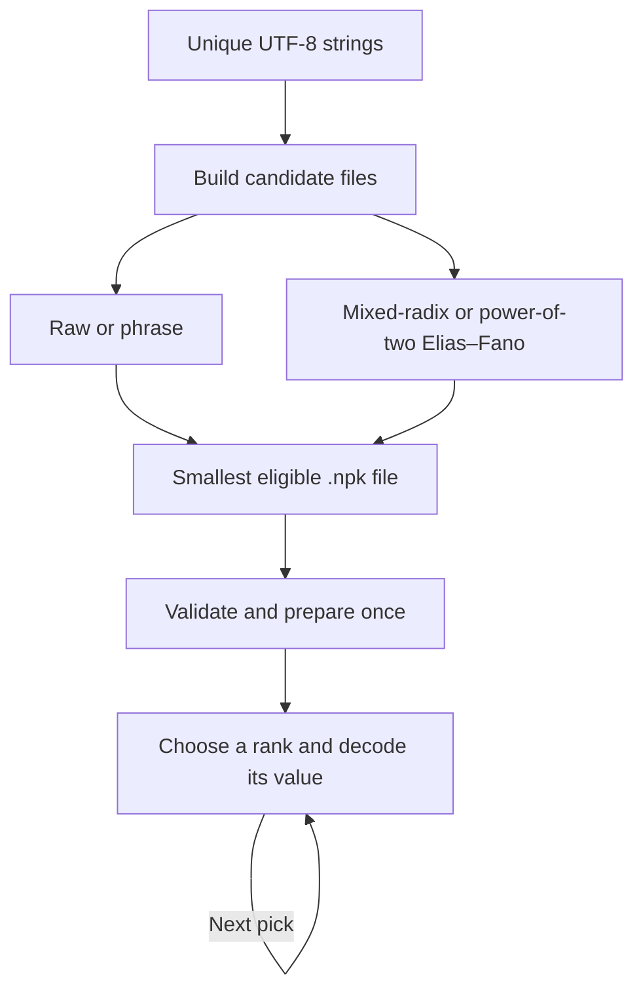
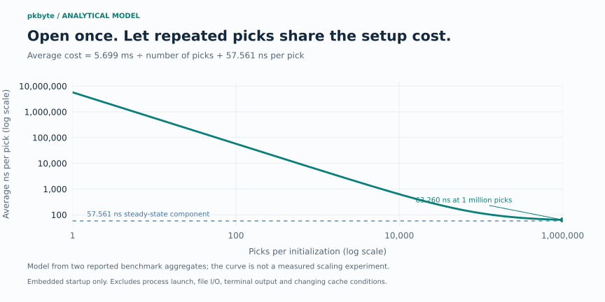

# Technical design: compression and random access

[Project overview](../README.md) · [Architecture and algorithms](../README.md#architecture-and-algorithms) · [Benchmarks](../README.md#benchmarks)

pkbyte is designed around one operation: choose a member of a fixed string set. That narrow workload lets it spend work during construction and preparation, then reuse the result for many picks. The compressed table remains available; each draw reconstructs one selected value.

The current implementation documents raw, phrase, mixed-radix Elias–Fano, and power-of-two Elias–Fano candidates. The examples below explain those ideas conceptually. Exact layouts, integer limits, and version rules belong to the [wire-format specification](FORMAT.md).



## 1. Compress the complete representation

A smaller payload can still produce a larger file if it needs a large dictionary or index. For an encoding candidate $c$, account for the complete representation:

```math
B(c)=B_{\mathrm{header}}(c)+B_{\mathrm{model}}(c)
     +B_{\mathrm{index}}(c)+B_{\mathrm{payload}}(c)+B_{\mathrm{padding}}(c).
```

The compact build policy compares complete candidate files. Conceptually, it selects:

```math
c^\star=\operatorname*{arg\,min}_{c\in\mathcal C} B(c).
```

Here, $\mathcal C$ contains the supported, eligible candidates considered by the builder. This is a choice among implemented representations, not a claim of globally optimal compression.

Raw storage is useful when a dataset is small, has little reusable structure, or exceeds a codec's limits. Comparing complete files makes that fallback a deliberate outcome. The resulting size depends on the strings, their shared structure, and the metadata required to retrieve them.

## 2. Distinct strings can share fragments

Consider:

```text
alpha-blue
alpha-green
beta-blue
```

The values are distinct, but fragments such as `alpha-` and `blue` recur. A phrase representation can store useful byte sequences in a shared dictionary and replace occurrences with compact codes. Decoding expands the selected value's codes against that dictionary.

This example illustrates the principle; it is not a dictionary emitted by the current builder. Phrase choice, coding rules, and dictionary overhead determine whether it saves space.

Static dictionaries that allow individual strings to be decoded are established research. [FSST][1] is relevant prior work. pkbyte's phrase candidate should not be confused with an implementation of FSST, and FSST's published performance is not evidence for pkbyte's performance.

## 3. Turn structured strings into integers

Mixed-radix coding is easiest to see with equal-length byte strings. Suppose each position has an ordered alphabet of size $a_j$, and the byte at that position has index $d_j$:

```math
x(s)=\sum_{j=0}^{m-1}d_j\prod_{k=j+1}^{m-1}a_k,
\qquad 0\le d_j<a_j,
\qquad 0\le x(s)<U=\prod_{j=0}^{m-1}a_j.
```

For `bar`, `bat`, and `car`, the positional alphabets can be `{b,c}`, `{a}`, and `{r,t}`. Their sizes are $2,1,2$:

| Stored string | Position digits | Integer |
| --- | --- | ---: |
| `bar` | $(0,0,0)$ | 0 |
| `bat` | $(0,0,1)$ | 1 |
| `car` | $(1,0,0)$ | 2 |

The universe contains four possible integers. Integer 3 would decode to `cat`, which is absent from this table. **Sampling must choose a rank among stored integers, not an arbitrary integer in the universe.**

These are byte-level examples; UTF-8 characters can occupy multiple bytes. The model must preserve the original byte sequences exactly.

A power-of-two variant allocates $w_j=\lceil\log_2 a_j\rceil$ bits per position. Shifts and masks can then extract digits, at the cost of unused bit patterns. This trades representation density against decoding work. Finite-width implementations must check arithmetic and eligibility; unsupported values require a supported fallback, rather than truncation.

## 4. Compress a sorted set of integers

Elias–Fano represents a sorted sequence compactly while supporting indexed recovery. For distinct integers

```math
0\le x_0<x_1<\cdots<x_{n-1}<U,
\qquad
\ell=\left\lfloor\log_2\frac Un\right\rfloor,
```

split each $x_i$ into high and low parts: $x_i=2^\ell h_i+l_i$. Store the low parts directly. In a high-part bitvector $H$, put a one at zero-based position $h_i+i$. Recovery is:

```math
x_i=\bigl(\operatorname{select}_1(H,i)-i\bigr)2^\ell+l_i.
```

Here, $\operatorname{select}_1(H,i)$ returns the position of the **zero-based** $i$-th one. This convention makes the indexing explicit.

For $n>0$, a conceptual payload bound is:

```math
B_{\mathrm{EF}}\le n\ell+n+
\left\lfloor\frac{U-1}{2^\ell}\right\rfloor
\le n\left(\left\lceil\log_2\frac Un\right\rceil+2\right).
```

Think roughly $\log_2(U/n)+2$ bits per integer, before alphabets, headers, padding, and access indexes. Those costs still matter to the complete file. [Vigna's account][2] explains the representation and access structures. Elias–Fano alone does not establish a worst-case constant-time bound for every implementation's select operation.

## 5. Give every stored value equal probability

For $N>0$ unique stored strings, obtain an unbiased rank:

```math
R\sim\operatorname{Uniform}\{0,\ldots,N-1\}.
```

If each rank decodes to exactly one stored string, then:

```math
\Pr[\operatorname{decode}(R)=s_i]=\frac1N.
```

Compression does not change this probability. If a physical representation contains groups of sizes $n_g$, the correct group probability is $n_g/N$, yielding $(n_g/N)(1/n_g)=1/N$ per member. Selecting a global rank achieves this without requiring a separate random group draw.

The mathematical guarantee assumes the source-word distribution required by the rank reducer. Simply taking a random machine word modulo $N$ can introduce bias when the source range is not divisible by $N$. Rejection-based reduction avoids that problem; [Lemire][3] describes an efficient multiply-and-reject method. This is algorithmic background, not a statement about the current default reducer.

The documented default generator is noncryptographic SplitMix64. A fixed seed gives a deterministic stream under the documented implementation contract. Selection is with replacement, so repeats are expected. Explicit deduplication removes source frequencies: two distinct stored values each receive probability $1/2$, even if one appeared more often in the input.

## 6. Preparation is an investment in repeated picks

The reported SSA measurements separate initialization from warm sampling. Using their medians, a simple explanatory model is:

```math
T(q)=5.699\,\mathrm{ms}+q\,(57.561\,\mathrm{ns}),
\qquad
\overline T(q)=\frac{5.699\,\mathrm{ms}}q+57.561\,\mathrm{ns}.
```



**This curve is calculated from two supplied medians; it is not a measured scaling series.** The initialization measurement starts from embedded bytes. The model excludes file I/O, CLI process startup, terminal printing, and workload changes.

It predicts approximately 627.461 ns per pick across 10,000 draws, 114.551 ns across 100,000, and 63.260 ns across one million. These averages include the modeled one-time preparation cost. A short-lived CLI invocation therefore has a different cost profile from a long-lived library picker.

The warm operation still includes selecting a rank, locating the entry, and reconstructing the output. Its cost depends on string length and representation; writing arbitrary output bytes is not free. See the [benchmark methodology and reports](../benchmarks/README.md#verification-workload-matrix) for the recorded workload and measurement boundaries.

## References

1. [Boncz, Neumann, and Leis. *FSST: Fast Random Access String Compression.* PVLDB 13(11), 2020.][1]
2. [Vigna. *Quasi-Succinct Indices.* WSDM, 2013.][2]
3. [Lemire. *Fast Random Integer Generation in an Interval.* ACM TOMACS 29(1), 2019.][3]

[1]: https://www.vldb.org/pvldb/vol13/p2649-boncz.pdf
[2]: https://vigna.di.unimi.it/ftp/papers/QuasiSuccinctIndices.pdf
[3]: https://arxiv.org/abs/1805.10941
